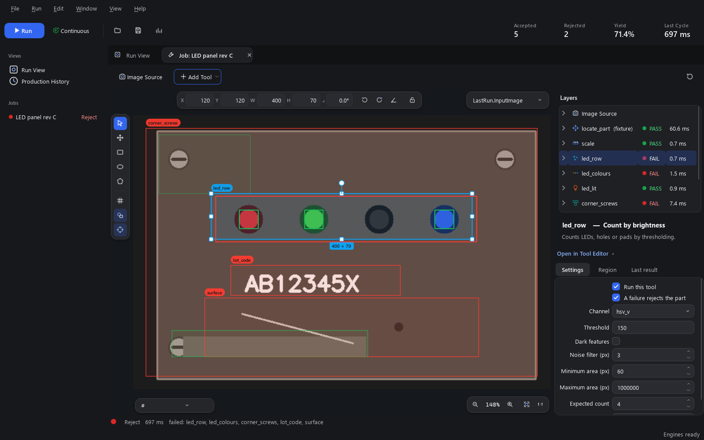
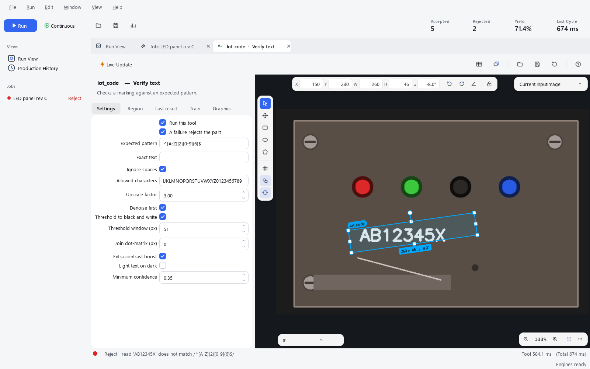

# Vision Station

**A desktop machine-vision application for automated visual inspection on production lines** — build an inspection recipe by drawing regions on a part image, run it against a camera or image files, and get a pass/fail verdict per part with traceable results.


*A rejected part in the Run View: the missing LED, the misprinted lot code, a scratch and a dent are each caught by a different check and outlined in red, while the counts, yield and results queue update live.*

---

## What it does

Vision Station is modelled on industrial tools such as Cognex VisionPro. An engineer teaches an inspection once, from a picture of a good part, and the line then runs it on every part:

1. **Locate the part.** A fixture tool finds the part's position and rotation, so every other region follows it when parts arrive shifted or turned.
2. **Draw the checks.** Each check is a region on the image: is a component present, are the LEDs the right colours and lit, is the lot code correct, are there scratches, is a dimension within tolerance.
3. **Run.** Each part gets an Accept or Reject, with the failing checks marked. Results go to a queue, a SQLite production history and, optionally, a PLC over TCP/IP.

It has **36 inspection tools** across ten groups: locating and calibration, presence and counting, colour, geometry and measurement, surface defects, OCR and barcodes, and trained models (YOLO detection, anomaly detection, classification).

## Screenshots

| | |
|---|---|
|  |  |
| **Job editor.** The image is a design canvas: every check's region can be selected, moved, resized and rotated in place. Layers and the selected tool's properties are on the right. | **Arranging regions.** Select several regions to align, distribute or match their sizes, as in Illustrator or Figma. |
|  |  |
| **Tool editor.** One check in detail. The region is rotated −8° to follow the print, its exact geometry is typed in the transform bar, and the status bar says why it rejected. | **Production history.** Yield per job and a Pareto of the checks that reject most parts, from the SQLite log, with CSV export. |

Every screen comes in light and dark themes that follow Windows; the [`docs/screenshots`](docs/screenshots) folder has both versions of each.

## Highlights

**Canvas editing like a design tool**
- Regions are edited directly on the image. Drag to move, use handles to resize, and drag the grip (or just outside a corner) to rotate.
- Shift keeps proportions or snaps to 15°, Alt resizes from the centre, and Shift-drag moves along one axis.
- Edges snap to the image and to other regions, with guides.
- Align, distribute, match size, lock, duplicate, and full undo/redo.
- Resizing a rotated region is done in scene space, so the opposite corner stays where it was.

**Built for the factory floor**
- Inspection runs on a worker `QThread` and results return through queued signals, so the interface never blocks.
- Every run is logged to SQLite by a background writer thread, and images of rejected parts are archived.
- A TCP/IP line interface lets a PLC or robot trigger inspections and read results.
- Operator mode locks editing behind a supervisor password (stored as a salted PBKDF2 hash).
- Basler cameras are opened and set up by the application itself - by IP address, so they work where GigE discovery does not - with every parameter (exposure, gain, white balance, rotation, trigger, sensor region, GigE transport) in one Settings window. OpenCV is the fallback.
- Each part's picture can be saved, annotated as the result page shows it and/or untouched, to a folder of your choice, without slowing the cycle.
- An application exports as a self-contained `.vsp` package with a small runtime (`vsruntime`), so it can run headless from other Python code.

**Machine learning without a GPU on the line**
- The built-in labelling workspace exports YOLO datasets. A Colab notebook trains the models.
- Inference runs on the CPU through OpenVINO, falling back to ONNX Runtime.
- Text is found and read by PP-OCRv6 through ONNX Runtime - on the GPU with `onnxruntime-directml` - at any angle and in large images (`python scripts/get_ocr_models.py` fetches the models). Barcodes and DataMatrix use pyzbar and pylibdmtx, with OpenCV's readers as backup.
- **Find parts (AI)**: a prompt-free YOLOE-26 network on the GPU proposes every component in an area of a board; you review the proposals and each kept part becomes a *Part present* check. *Find all like this* finds every copy of one part by template matching.

## Engineering notes

A few problems from this project, and how they were solved:

- **A crash that left no error message.** The application would occasionally exit mid-use with no traceback. Python's `faulthandler`, a native minidump written from a `SIGABRT` hook, and return addresses mapped against Qt's DLL export tables traced it to a *pure virtual function call* inside `QGraphicsScene::drawItems`. The cause: region outlines that change size with the zoom level without notifying Qt's spatial index (a BSP tree), which then held stale pointers to deleted items. The fix was reproduced deterministically before and after (3 of 3 runs crashed, then 0 of 3), and a regression test runs the scenario in a subprocess.
- **Silent data loss on non-ASCII paths.** On Windows, OpenCV's `imread` and `imwrite` fail without any error on paths outside the system code page, such as a user folder named `Gökul`. Reference images and the archive of rejected parts were never written. All image I/O now goes through a Unicode-safe module (`vision_station/core/imio.py`).
- **Accessibility.** Every text colour meets WCAG AA contrast in both themes, keyboard focus is always visible, and empty states explain themselves.
- **Testing.** More than 570 automated tests cover the inspection tools, measurement accuracy, the canvas interactions (driven by real mouse events), the application windows, packaging and installation.

## Tech stack

| Area | Technology |
|---|---|
| Language | Python 3.11 |
| UI | PySide6 (Qt 6): Widgets, Graphics View, MDI workspace |
| Vision | OpenCV, NumPy |
| ML inference | ONNX Runtime (DirectML / CUDA / CPU), OpenVINO - text reading, deep surface check (PatchCore on ResNet-18), YOLO |
| OCR and codes | PP-OCRv6 (ONNX), pyzbar, pylibdmtx, OpenCV |
| Storage | JSON recipes, SQLite results log |
| Cameras | Basler Pylon (pypylon), OpenCV capture |
| Testing | pytest, Qt Test |

## Getting started

```bash
pip install -r requirements.txt   # or double-click install.bat on Windows
python scripts/preflight.py       # reports what is installed and what each package is for
python -m vision_station          # or run.bat
```

The application opens the included synthetic demo, **`projects/demo_led_panel`**: an LED panel with a good and a defective part image. Press **F5** to inspect.

### Two views

The switch at the top left has three views, and that is the whole application for most people:

- **Run** — the verdict in large type with the reasons in words ("Lot code: read 'AB12345X', which does not match the expected pattern"), the part image with every check outlined, and the recent parts. Run (F5) inspects one part; Continuous (F6) inspects every part as it comes.
- **Build** — set up what to check. A guide ticks off the five steps. *Add a check* asks what you want to know ("Is the text or code right?", "Is the surface clean?") rather than which algorithm you want; each check shows its few essential settings with a sentence under each, and *Show all settings* for the rest.
- **History** — yield over time and the checks that reject most parts.

**Settings** (the gear, top right, or Ctrl+,) holds everything in one window: appearance and **Advanced mode** — the full VisionPro-style engineering view with menu bar, Toolbox, every tool and setting, Layers with input/output terminals and document tabs — the camera, result pictures, the line connection and Operator Mode. **More** (…) holds projects and packages. Both views edit the same recipe.

Run the tests:

```bash
python -m pytest            # or run_tests.bat
```

## Multi-side jobs

One product photographed from several sides is one application with one inspection per side, each with its own fixture, a trained surface check over the whole panel and named checks for what the line asks about that side. The application exports as one `.vsp` package; a plain Python script with no Qt loads it with `vsruntime.load`, inspects each side's picture with `app.run(frame, job=side)` and gets every verdict and the annotated pictures — the same two calls serve a PLC-triggered line (see `examples/example_run_package.py`).

What multi-side work taught the tools:
- The fixture's *features* method uses SIFT, a ratio test, RANSAC on a downscaled window, and scores the located part by correlation rather than inlier ratio — softer photographs of a faulty unit matched with 50 consistent points and a ratio of 0.07, and were being rejected by the fixture instead of by the check that names the defect.
- The trained surface check has a *Model resolution* (1600 px for a whole panel on a 12-megapixel photo; a hairline scratch vanished at 640), *Ignore slow lighting changes* for parts photographed under a lamp that drifts, and refuses to call a 4-pixel margin a separation.

## Project layout

```
vision_station/              the application package  (python -m vision_station)
├── paths.py                 where models/, projects/, assets/ and logs/ are
├── core/                    no user interface
│   ├── engine.py            projects and the inspection engine
│   ├── job.py, schema.py    multi-side applications, tool settings
│   ├── results.py           SQLite results log and image archive
│   ├── result_images.py     annotated result pictures, saved in the background
│   ├── package.py           .vsp export and import
│   ├── vsruntime.py         standalone runtime for running a package from other code
│   ├── part_finder.py       Find parts (AI)
│   ├── inference.py         ONNX Runtime / OpenVINO, CPU or GPU
│   ├── comms.py             TCP/IP line interface
│   └── preflight.py         installation check
├── hardware/camera.py       Basler pylon cameras (by IP address), OpenCV fallback
├── tools/                   the 40 inspection tools
└── ui/                      the windows
    ├── design.py            THE LOOK: fonts, colours, sizes, the whole stylesheet
    ├── theme.py             applies design.py, light or dark
    ├── main_window.py       run view, job editor, tool editor, history
    ├── settings_dialog.py   Settings: camera, results, line, appearance, security
    ├── canvas.py, display.py   the image canvas and display
    └── ...
scripts/                     install, preflight, model download and export helpers
examples/                    using an exported package from your own code
benchmarks/                  accuracy and speed benchmarks
tests/                       the test suites, with a stand-in camera
assets/fonts/                Inter (SIL Open Font License)
models/                      neural networks (fetched or built by scripts/, not in git)
projects/demo_led_panel/     the synthetic demo
docs/MANUAL.md               full user and engineering documentation
```

To change how the application looks, edit `vision_station/ui/design.py` — or put
stylesheet rules in `vision_station/ui/ui_custom.qss` to try them without touching Python.

## Documentation

[`docs/MANUAL.md`](docs/MANUAL.md) is the full manual: every tool, the model-training workflow, camera set-up, the line protocol, accuracy audits and a detailed engineering log.

## License

[MIT](LICENSE) © 2026 Gokul PV
