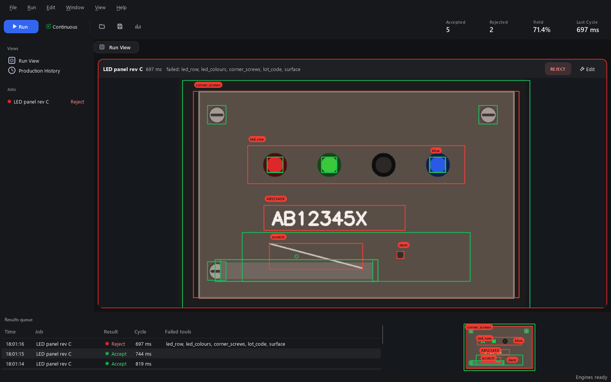
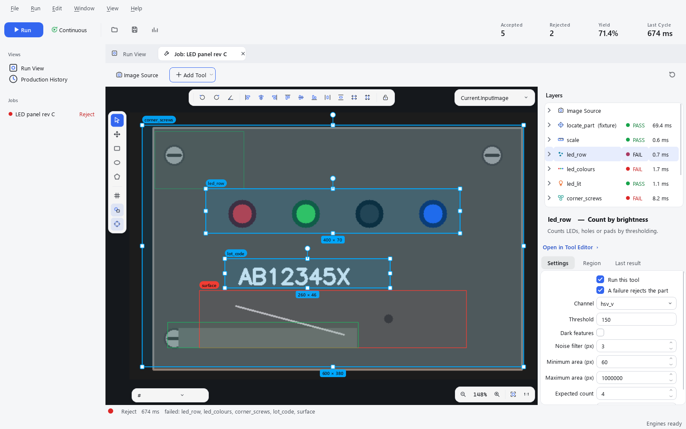
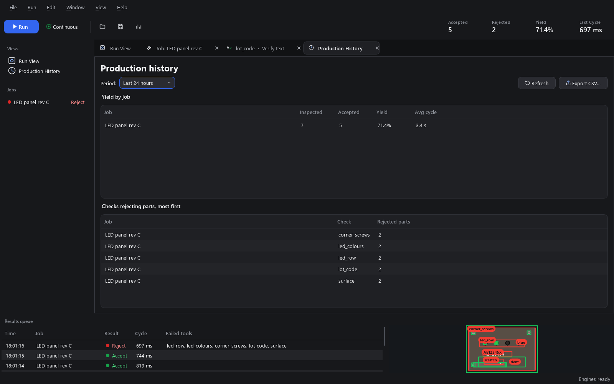

# Vision Station

**A desktop machine-vision application for automated visual inspection on production lines** — build an inspection recipe by drawing regions on a part image, run it against a camera or image files, and get a pass/fail verdict per part with traceable results.




*A rejected part in the Run View: the missing LED, the misprinted lot code, a scratch and a dent are each caught by a different check and outlined in red, while the counts, yield and results queue update live.*

---

## What it does

Vision Station is modelled on industrial tools such as Cognex VisionPro. An engineer teaches an inspection once, from a picture of a good part, and the line then runs it on every part:

1. **Locate the part.** A fixture tool finds the part's position and rotation, so every other region follows it when parts arrive shifted or turned.
2. **Draw the checks.** Each check is a region on the image: is a component present, are the LEDs the right colours and lit, is the lot code correct, are there scratches, is a dimension within tolerance.
3. **Run.** Each part gets an Accept or Reject, with the failing checks marked. Results go to a queue, a SQLite production history and, optionally, a PLC over TCP/IP.

It has **40 inspection tools** across ten groups: locating and calibration, presence and counting, colour, geometry and measurement, surface defects, OCR and barcodes, and trained models (YOLO detection, anomaly detection, classification).

## Screenshots

| | |
|---|---|
|  |  |
| **Job editor.** The image is a design canvas: every check's region can be selected, moved, resized and rotated in place. Layers and the selected tool's properties are on the right. | **Arranging regions.** Select several regions to align, distribute or match their sizes, as in Illustrator or Figma. |
|  |  |
| **Tool editor.** One check in detail. The region is rotated −8° to follow the print, its exact geometry is typed in the transform bar, and the status bar says why it rejected. | **Production history.** Yield per job and a Pareto of the checks that reject most parts, from the SQLite log, with CSV export. |

Every screen comes in light and dark themes that follow Windows; the [`docs/screenshots`](docs/screenshots) folder has both versions of each.

## Highlights

**Canvas editing like a design tool**
- Regions are edited directly on the image. Drag to move, use handles to resize, and drag the grip (or just outside a corner) to rotate.
- Shift keeps proportions or snaps to 15°, Alt resizes from the centre, and Shift-drag moves along one axis.
- Edges snap to the image and to other regions, with guides.
- Align, distribute, match size, lock, duplicate, and full undo/redo.
- Resizing a rotated region is done in scene space, so the opposite corner stays where it was.

**Built for the factory floor**
- Inspection runs on a worker `QThread` and results return through queued signals, so the interface never blocks.
- Every run is logged to SQLite by a background writer thread, and images of rejected parts are archived.
- A TCP/IP line interface lets a PLC or robot trigger inspections and read results.
- Operator mode locks editing behind a supervisor password (stored as a salted PBKDF2 hash).
- Basler cameras are supported through Pylon, with OpenCV as the fallback.
- An application exports as a self-contained `.vsp` package with a small runtime (`vsruntime.py`), so it can run headless from other Python code.

**Machine learning without a GPU on the line**
- The built-in labelling workspace exports YOLO datasets. A Colab notebook trains the models.
- Inference runs on the CPU through OpenVINO, falling back to ONNX Runtime.
- OCR uses PaddleOCR, falling back to Tesseract. Barcodes and DataMatrix use pyzbar and pylibdmtx.

## Engineering notes

A few problems from this project, and how they were solved:

- **A crash that left no error message.** The application would occasionally exit mid-use with no traceback. Python's `faulthandler`, a native minidump written from a `SIGABRT` hook, and return addresses mapped against Qt's DLL export tables traced it to a *pure virtual function call* inside `QGraphicsScene::drawItems`. The cause: region outlines that change size with the zoom level without notifying Qt's spatial index (a BSP tree), which then held stale pointers to deleted items. The fix was reproduced deterministically before and after (3 of 3 runs crashed, then 0 of 3), and a regression test runs the scenario in a subprocess.
- **Silent data loss on non-ASCII paths.** On Windows, OpenCV's `imread` and `imwrite` fail without any error on paths outside the system code page, such as a user folder named `Gökul`. Reference images and the archive of rejected parts were never written. All image I/O now goes through a Unicode-safe module (`imio.py`).
- **Accessibility.** Every text colour meets WCAG AA contrast in both themes, keyboard focus is always visible, and empty states explain themselves.
- **Testing.** More than 530 automated tests cover the inspection tools, measurement accuracy, the canvas interactions (driven by real mouse events), the application windows, packaging and installation.

## Tech stack

| Area | Technology |
|---|---|
| Language | Python 3.11 |
| UI | PySide6 (Qt 6): Widgets, Graphics View, MDI workspace |
| Vision | OpenCV, NumPy |
| ML inference | OpenVINO, ONNX Runtime (YOLOv8, anomaly detection, text detection) |
| OCR and codes | PaddleOCR, Tesseract, pyzbar, pylibdmtx |
| Storage | JSON recipes, SQLite results log |
| Cameras | Basler Pylon (pypylon), OpenCV capture |
| Testing | pytest, Qt Test |

## Getting started

```bash
pip install -r requirements.txt   # or double-click install.bat on Windows
python preflight.py               # reports what is installed and what each package is for
python vp_app.py                  # or run.bat
```

The application opens the included synthetic demo, **`projects/demo_led_panel`**: an LED panel with a good and a defective part image. Press **F5** to inspect.

Run the tests:

```bash
python -m pytest tests.py tests_vp.py tests_package.py -q
```

## Project layout

```
vp_app.py          main application: run view, job editor, tool editor, history
vp_display.py      the shared image display with floating tool bars
canvas.py          the region canvas: selection, transform, snapping, drawing
engine.py          projects and the inspection engine
vstools/           the 40 inspection tools
job.py, package.py multi-job applications and .vsp packaging
vsruntime.py       standalone runtime for running a package from other code
results.py         SQLite results log and image archive
comms.py           TCP/IP line interface
theme.py, icons.py design tokens, stylesheet and SVG icon set
tests*.py          the test suites
docs/MANUAL.md     full user and engineering documentation
```

## Documentation

[`docs/MANUAL.md`](docs/MANUAL.md) is the full manual: every tool, the model-training workflow, camera set-up, the line protocol, accuracy audits and a detailed engineering log.

## License

[MIT](LICENSE) © 2026 Gokul PV
